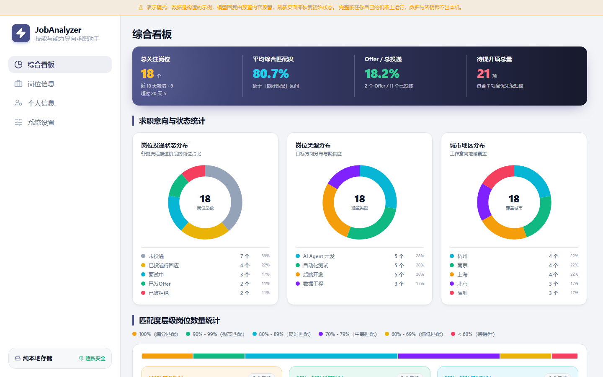
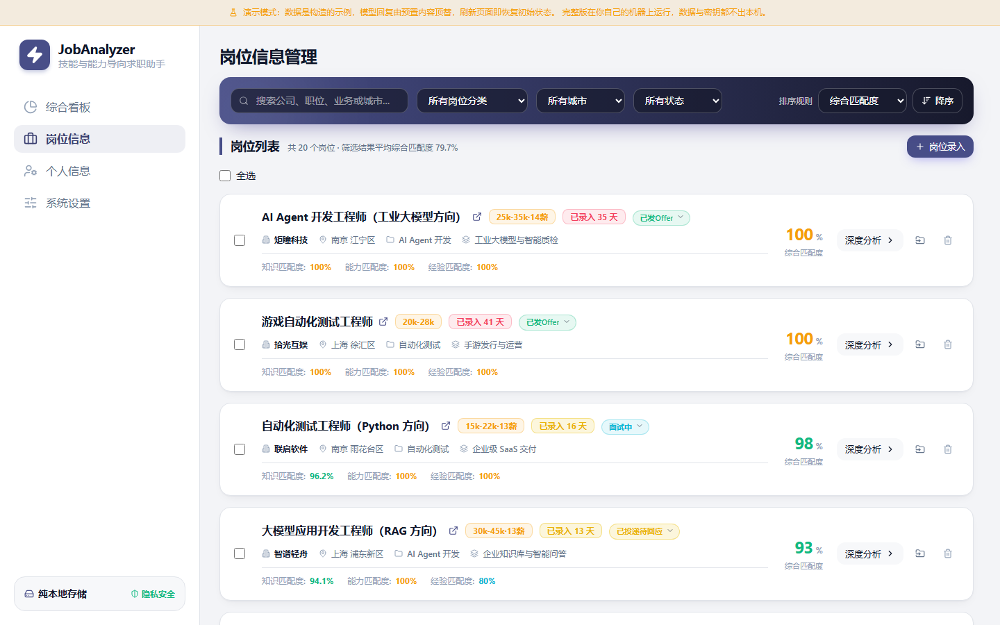
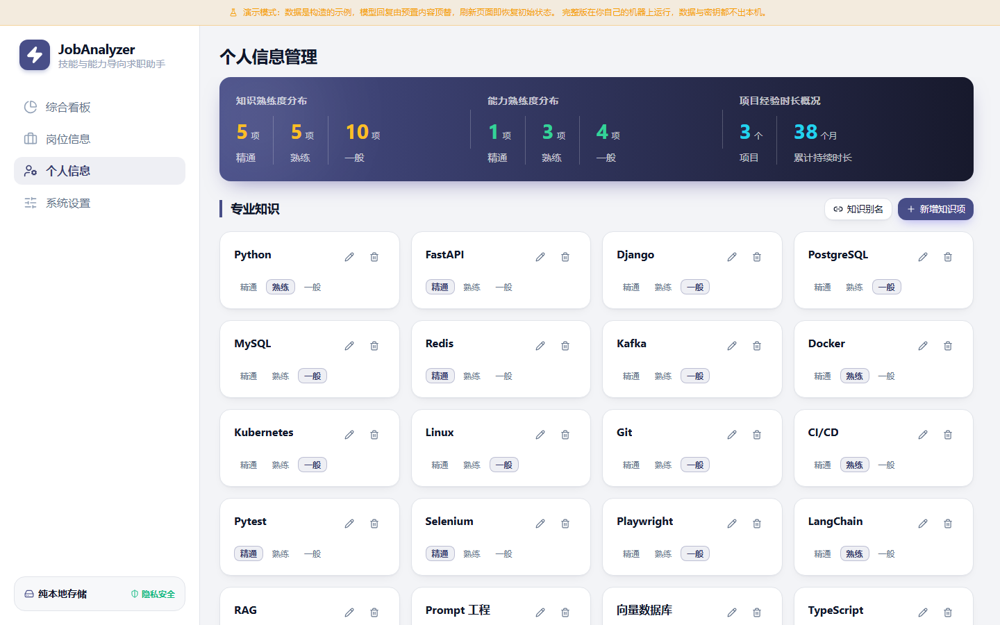
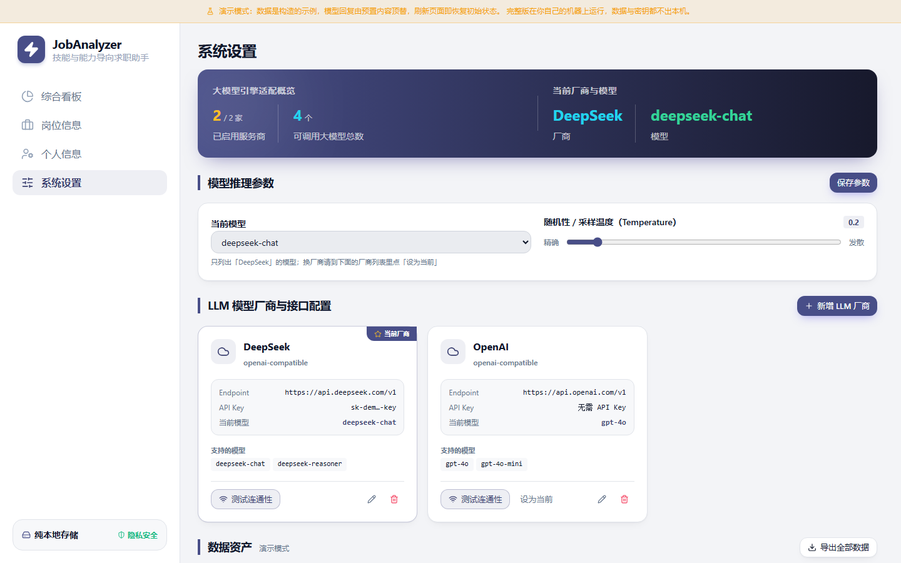

# JobAnalyzer · 技能与能力导向求职助手

[](https://github.com/cylemon/JobAnalyzer/actions/workflows/deploy-demo.yml)
[](https://cylemon.github.io/JobAnalyzer/)

把招聘 JD 变成**结构化的要求清单**，逐条对照自己的知识、能力与项目经验，
算出"这个岗位我到底差在哪、还差多少"——而不是只收藏一堆链接。

一个跑在自己机器上的单机工具：数据存在本地 SQLite 文件里，模型调用由你自己配置的厂商完成。

**▶ [在线演示](https://cylemon.github.io/JobAnalyzer/)** —— 点开就能用，无需注册、无需密钥。
演示站是静态页面，整套后端逻辑跑在浏览器里（见 [demo/README.md](demo/README.md)），
里面的数据是构造的示例、模型回复由预置内容顶替。

| 综合看板 | 岗位信息 |
| --- | --- |
|  |  |
| **个人信息** | **系统设置** |
|  |  |

## 它解决什么问题

这个工具针对的是**同时看的岗位多、投递战线拉得长**的求职场景：手上攒着几十份 JD，
流程要走好几周甚至几个月。这种情况下，两件事会变得非常费劲：

1. **逐个岗位对齐差距**：一份 JD 里混着职责、要求、加分项、福利，人眼扫过去抓不住重点；
   同一条"熟悉 Kafka"，有人是"用过"、有人是"调过线上故障"，光看字面判断不了自己差多少。
   岗位一多，靠记忆和印象去逐个核对，既慢又不可靠。
2. **跨岗位看共性、排优先级**：几十个岗位的要求是交叉的——哪些是反复出现的高频要求、
   先补哪几项收益最大，凭感觉排等于没有排。共性要求恰恰是最值得优先准备的。

JobAnalyzer 把这两件事都落成结构化数据：

- **逐条对齐**：JD 被拆成逐条要求（知识 / 能力 / 经验三类），每条带上"要求到什么程度"，
  再与你的个人资产逐条比对，给出四档结论（完全匹配 / 需提升 / 不匹配 / 未判定），
  每条都能看到"凭什么这么判"；
- **跨岗位聚合**：把众多岗位的要求归并到一起，按"多少个岗位提到了它"排序，
  得到该方向的共性要求与高频缺口，以及针对性的成长路线；
- **长周期跟踪**：每个岗位的状态从「未投递」一路记到「已投递待回应 / 面试中 / 已发 Offer /
  已被拒绝」，几个月后回看，当时的判断依据和进展都还在。

反过来说：**岗位只有三五个、一两周内就投完的话，其实没必要动用这个工具**——
用表格维护就够了。它的价值随岗位数量和时间跨度增长，这两个正是它为之前提。

## 核心能力

- **JD 结构化提取**：粘贴文本或拖入截图，模型拆出公司、职位、薪资、城市、业务领域，
  以及逐条要求（含"要求精通/熟练/一般"的程度）。支持一次传多张截图合并成一个岗位。
- **逐条匹配判定**：知识类由本地精确比对自评等级，能力与经验类由模型对照个人履历给出结论与依据。
  每条结论都能看到"凭什么这么判"。
- **资产一改就自动重评**：改动知识项或能力自评后自动重新评估受影响的要求，
  让分数始终与当前资产一致（去抖 5 秒，失败不静默）。
- **跨分类的岗位看板**：筛选、排序、搜索与聚合口径全部在服务端算一次，界面不做第二套。
- **分类综合分析**：匹配度分层、能力雷达、缺口排行，以及流式生成的成长路线。
- **多模型厂商**：DeepSeek / OpenAI / 通义 / 智谱 / Kimi / Ollama 等 OpenAI 兼容端点，
  运行时可切换；厂商差异收敛在一个适配器里，业务代码不感知。
- **数据自主**：整库备份与恢复、全量 JSON 导出、技能别名归一、动态字段。
  备份是整库快照（含厂商配置），既能回滚，也能在换机器后原样带回来。

## 技术栈

| 层 | 选型 | 说明 |
| --- | --- | --- |
| 前端 | React 19 + TypeScript + Vite 7 | 无路由库，hash 路由；样式用 Tailwind 4 + 一层设计令牌 |
| 后端 | Hono + Node | 单进程既发 API 也托管前端产物 |
| 数据 | SQLite（better-sqlite3 + Drizzle ORM） | 单文件库，启动即自动迁移 |
| 校验 | zod | 同一份契约前后端共用，响应逐个字段校验 |
| 测试 | Vitest | 32 个文件、312 个用例，覆盖领域计算、服务与路由 |

## 架构

前后端共用一份**契约**（`shared/`），业务计算集中在服务端，前端只负责展示与交互：

```
web/                     React 界面；services/api.ts 是唯一的 HTTP 出口
  ├─ views/              四个页面：综合看板 / 岗位信息 / 个人信息 / 系统设置
  ├─ components/         公共组件（页头、卡片、弹窗、反馈条…）
  └─ lib/                设计令牌的语义映射、格式化、档位

server/                  Hono 应用；app.ts 组装路由，index.ts 只负责监听
  ├─ routes/             11 组接口、56 个端点
  ├─ services/           业务服务：提取、判定、看板聚合、重评、备份…
  ├─ llm/                模型适配层：提示词、OpenAI 兼容协议、连通性探测
  ├─ db/                 Drizzle 表结构与迁移（14 份，启动自动应用）
  └─ config/             路径、厂商预设、设置读写

shared/                  前端与后端共享的领域模型与 zod 契约
demo/                    静态演示站：把上面这套后端搬进浏览器（见其 README）
docs/spec/               需求、架构、构建规范
prototype/               界面定稿前的静态原型（设计留档）
```

三条贯穿全项目的工程原则（见 [04-construction.md](docs/spec/04-construction.md)）：
**失败必须显性**（任何失败路径都要给出可读的原因，不许静默降级）、
**口径只有一处**（同一个数字的计算方式不许有第二份实现）、
**厂商不渗入业务**（换模型厂商 = 加一个适配器，不改业务代码）。

## 本地运行

> **下面这些是「从源码跑起来」的方式，属于开发阶段的运行形态**，需要 Node 20.19+ 与 npm。
>
> 面向一般用户的形态，计划是打包成**双击即用的本地单机程序**（Windows 上的 .exe 等），
> 不需要装 Node、不碰命令行。打包功能目前**尚未实现**，所以现在想用的话，
> 只能按本节的方式从源码启动。

```bash
npm install
npm run dev          # 开发模式：前端 5173 + 服务 8787，浏览器打开 http://127.0.0.1:5173
```

首次启动会自动建库并应用迁移。之后到「系统设置」里添加一家模型厂商（填入 Base URL、模型名、
API Key；本地 Ollama 之类的服务不需要密钥），点「测试连通性」确认可用，就可以开始录岗位了。

不想改代码、只想当成品用的话，走「构建 + 单进程」这一条，两个命令都要执行
（`npm start` 托管的是 `npm run build` 的产物，缺了这一步打开只会看到空白页）：

```bash
npm run build        # 构建前端产物到 web/dist
npm start            # 单进程模式：打开 http://127.0.0.1:8787 就是完整应用

npm run typecheck    # 类型检查
npm test             # 单元测试
npm run db:generate  # 改过表结构后生成迁移
```

数据默认落在 `data/`（数据库、备份、厂商配置），可以用环境变量 `JOBANALYZER_DATA_DIR` 指到别处——
自动化测试与隔离实例就靠它，避免动到你日常使用的那份数据。

## 演示站

演示站不是录屏，也不是截图：它是**同一份代码**编译到浏览器里运行的结果，
连后端路由与业务计算都是同一套，只是把数据库换成 WASM 版 SQLite（sql.js）、
把模型调用换成预置实现。做法、边界与踩过的坑见 [demo/README.md](demo/README.md)。
本地复现：

```bash
npm run demo:snapshot    # 从本地库导出演示数据快照
npm run build:demo       # 产物在 web/dist-demo（单独目录，不会覆盖 web/dist）
```

推送 `main` 分支会触发 [.github/workflows/deploy-demo.yml](.github/workflows/deploy-demo.yml)：
先跑类型检查与测试，再构建并发布到 GitHub Pages。

## 文档

| 文档 | 内容 |
| --- | --- |
| [01-usageExamples](docs/spec/01-usageExamples.md) | 典型使用流程举例 |
| [02-requirements](docs/spec/02-requirements.md) | 功能需求与暂缓清单（每条都写明处置结论） |
| [03-architecture](docs/spec/03-architecture.md) | 技术选型与模块划分 |
| [04-construction](docs/spec/04-construction.md) | 构建约束与三条工程原则 |
| [05-architecture-overview](docs/spec/05-architecture-overview.md) | 架构总览：14 张图、56 个端点索引与已知缺陷表 |

## 隐私

没有账号、没有云端、没有遥测。所有数据都在本机的 `data/` 目录里，
模型调用直接发往你自己配置的厂商，不经过任何中间服务。
`data/`（含密钥）与 AI 工具的本机配置都在 `.gitignore` 里，从不入库。
