# JobAnalyzer 架构总览

> 本文描述 JobAnalyzer **当前实现**的完整技术架构：技术选型、分层结构、数据模型、核心算法、关键流程与工程约束。
> 快照时间：2026-10-10。
>
> **与同目录其它 spec 的分工**：`02-requirements.md` 是需求与语义的真相，`03-architecture.md` 是数据契约与算法口径的真相，
> `04-construction.md` 是构建过程与决策记录；**本文（`05-architecture-overview.md`）是把三者与代码实现合起来讲清楚的架构总览**——
> 口径冲突时以 02/03 为准，代码现状以本文为准。
> 本文末尾 §12 记录了实现与文档之间尚未同步的偏差，以及核实的代码缺陷。

---

## 目录

1. [系统定位与边界](#1-系统定位与边界)
2. [技术选型](#2-技术选型)
3. [总体架构](#3-总体架构)
4. [目录结构与模块地图](#4-目录结构与模块地图)
5. [后端架构](#5-后端架构)
6. [数据模型](#6-数据模型)
7. [核心算法](#7-核心算法)
8. [关键流程](#8-关键流程)
9. [前端架构](#9-前端架构)
10. [HTTP 接口清单](#10-http-接口清单)
11. [非功能性设计](#11-非功能性设计)
12. [运行、测试与已知偏差](#12-运行测试与已知偏差)
13. [附录](#13-附录)

---

## 1. 系统定位与边界

### 1.1 一句话定位

一个**单机本地**的求职分析工具：用户录入自己的知识 / 能力 / 项目经验，把目标岗位（JD 文本或截图）交给大模型拆成
一条条**要求条目**，再由本地算法算出「这个岗位我差多少、差在哪」，并把跨岗位的共性短板聚合成一张提升清单。

### 1.2 两条不可让渡的性质

| 性质 | 含义 | 架构上的落点 |
| --- | --- | --- |
| **数据不出本机** | 岗位与个人资产只存在本机 SQLite；只有「解析岗位」与「生成成长路线」两件事出网 | 服务只监听 `127.0.0.1`；密钥只落 `data/config.json`（`0o600`）或环境变量；无账号体系、无遥测 |
| **算分不花 Token** | 匹配度、分布统计、缺口排行、过时检测全部本地计算，**打开任何页面都不产生请求** | 打分 / 分档 / 缺口聚合是 `shared/domain/` 的纯函数；AI 大文本一律"无缓存只给按钮，绝不自动请求" |

### 1.3 明确的非目标

不做在线服务、账号体系、多人协作、移动端适配、自动投递、爬取招聘网站、岗位推荐、语义检索（暂缓）、
外部向量数据库；**不做「AI 直接给总分」**——任何分数都必须能拆解成要求条目。

### 1.4 规模假设

单用户；岗位 10² 量级、要求条目 10³ 量级、个人知识 10² 量级；本地计算路径在 10² 岗位下 P95 < 100ms。
使用节奏是**集中录入、反复查看**——这正是"录入时多花 Token、之后全部本地"这一取舍的依据。

---

## 2. 技术选型

### 2.1 选型总表

| 层 | 选用 | 版本 | 为什么是它 |
| --- | --- | --- | --- |
| 前端框架 | **React** | 19.1.1 | 组件化 + 类型安全；生态成熟，无需为本地工具引入框架级复杂度 |
| 构建 / 开发服务器 | **Vite** | 7.1.7 | 冷启动极快；`server.proxy` 顺带解决开发期的跨端口问题 |
| 语言 | **TypeScript** | 5.9.2 | 全仓 `strict` + `noUncheckedIndexedAccess`，前后端与测试共用一套类型 |
| 样式 | **Tailwind CSS v4**（CSS-first） | 4.1.13 | 无配置文件、令牌写进 CSS；标签化 UI 迭代快 |
| 组件层 | **自建**（`web/components/ui/`） | — | 只有 7 个基础件，引组件库的适配成本高于自写 |
| 图标 | **lucide-react** | 0.544.0 | 原型用 Font Awesome，这边取同形替代 |
| 类名合并 | clsx + tailwind-merge | 2.1.1 / 3.3.1 | 统一走 `web/lib/utils.ts` 的 `cn()` |
| 本地服务 | **Node.js + Hono** | Node 24.15 / hono 4.9.7 | 轻量、TS 优先、**SSE 支持好**；同时承载 LLM 转发（规避浏览器直连的 CORS 与密钥暴露） |
| 数据库 | **SQLite**（better-sqlite3） | 12.2.0 | 单文件无服务、同步 API 简单可靠；JSON 函数与窗口函数可用 |
| ORM / 迁移 | **Drizzle ORM + drizzle-kit** | 0.44.5 / 0.31.4 | 类型推导完整、SQL-like 语法适合本项目的聚合查询；迁移是可读可审查的 `.sql` |
| 运行时校验 | **zod** | 4.1.11 | `shared/schemas/` 的唯一类型来源；同一个 schema 既校验 LLM 返回也校验前后端契约 |
| LLM 接入 | 自建适配器 + **OpenAI 兼容协议** | — | 不绑定厂商；厂商差异收敛在 `server/llm/` |
| 流式输出 | **SSE**（服务端 `streamSSE` → 前端 `fetch` 流式读取） | — | 由本地服务代理转发，浏览器不直连厂商 |
| 测试 | **Vitest** | 3.2.4 | 与 Vite 同源；`environment: 'node'`，无 jsdom |
| 进程编排 | tsx watch + concurrently | 4.20.5 / 9.2.1 | `npm run dev` 一条命令起前后端 |

**硬件无关**：better-sqlite3 是原生模块，安装期需匹配当前 Node ABI 的 prebuild 或本地编译工具链。

### 2.2 关键选型理由

- **为什么需要本地服务，而不是纯前端 + IndexedDB？**
  浏览器直连 Anthropic / Ollama 有 CORS 限制，密钥也不该落 localStorage；且"数据不出本机"用 SQLite 单文件
  比浏览器存储更容易备份、导出与迁移。代价是需要跑一个 Node 进程。
- **为什么不做桌面端（Tauri / Electron）？**
  桌面壳在这里只解决「双击启动」一个问题，却要额外维护一套打包与权限体系。本地服务 + 浏览器已经满足
  「单机、数据不出本机」的全部要求 —— 这是一个**明确决定不做**的选项，不是待办。
- **为什么不引路由库 / 状态库 / 请求库？**
  只有 4 个页面、页面间零共享状态、唯一的跨页状态通道是 URL hash。引 react-router + redux + react-query
  要写更多样板，换不来这个规模下的任何收益。详见 §9.3。
- **为什么不用图表库？**
  三张环形图与一张雷达图都是手写 SVG——只有两种图形，且需要严格贴合设计令牌（颜色必须是色族变量），
  图表库的自定义成本高于直接画。
- **为什么不引组件库？**
  界面强依赖一套自有的设计令牌与语义色映射（§9.5）。组件库会带进第二套颜色与间距体系。
- **厂商预设表是模板不是白名单**：Base URL、模型名均可自由改，非 OpenAI 兼容协议（Claude 原生 Messages、
  Ollama 原生）只需新增一个 `protocol` 与适配器，**业务代码零改动**。

### 2.3 明确不选的

| 不选 | 原因 |
| --- | --- |
| 外部向量数据库 / 语义检索 | 岗位与知识量级只有 10²–10³，本地余弦计算足够；已列入暂缓清单 |
| ORM 之外的查询构建器 | Drizzle 已覆盖，重复引入会造成两套口径 |
| WebSocket | 唯一的长连接需求是单向流式生成，SSE 足够且实现更简单 |
| 服务端渲染 / 静态站点生成 | 单机工具，首屏不需要 SEO 或流式 HTML |

---

## 3. 总体架构

### 3.1 系统上下文图

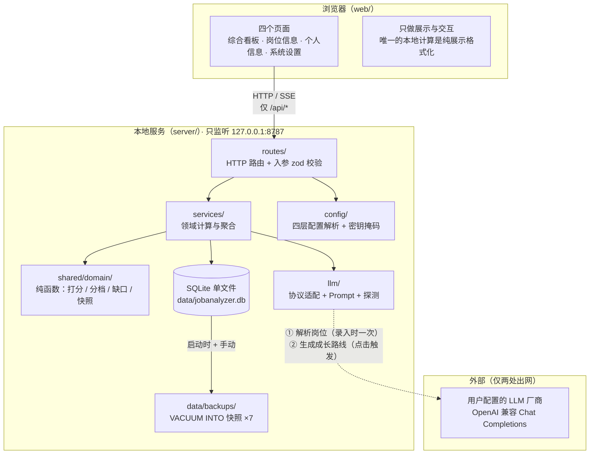

### 3.2 分层与依赖方向

依赖**单向向下**，禁止反向 import；`shared/` 是最底层的公共地基，被两侧共同依赖。

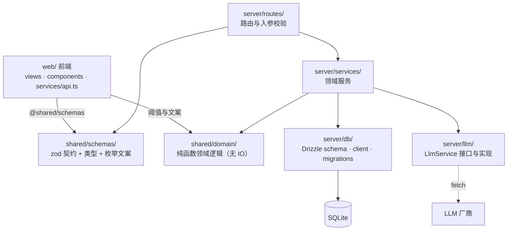

**四条架构约束**（改动时不得违反）：

1. **计算在服务端**：`shared/domain/` 与 `server/services/` 承载全部业务计算，前端只负责渲染与交互。
   前端不得复制一份匹配算法——那必然导致两侧口径分裂。前端唯一允许的计算是**展示层聚合**
   （如个人信息页顶部的熟练度分布统计）。
2. **契约在 `shared/`**：`shared/schemas/` 是前后端类型的唯一来源；请求与响应双向都过 zod。
3. **纯函数优先**：算法（打分、分层、聚合、优先级）写成不依赖数据库的纯函数，由服务端调用、由单元测试覆盖；
   数据库只负责取数与写回。
4. **上传与解析分离**：图片只在上传的那一刻经过内存，解析完即丢弃；不落盘、不留副本。

### 3.3 进程与端口

| 进程 | 地址 | 启动方式 |
| --- | --- | --- |
| 本地 API 服务 | `http://127.0.0.1:${PORT:-8787}` | `tsx watch server/index.ts` |
| 前端 dev server | `http://localhost:5173` | `vite`（`root: 'web'`，`/api` 代理到 API 服务） |
| 两者一起 | — | `npm run dev`（concurrently） |

监听地址**硬编码为 `127.0.0.1`**（[server/index.ts:27](server/index.ts#L27)），
没有任何配置项能让它对外提供服务——这是"数据不出本机"的第一道结构性保证。

前端要连哪个后端由 `JOBANALYZER_API_TARGET` 决定（默认 `http://127.0.0.1:8787`，
[vite.config.ts:10](vite.config.ts#L10)），用于「起一套隔离数据跑界面」。

---

## 4. 目录结构与模块地图

```
shared/                     前后端共享地基（无 IO、不 import server/web）
  schemas/                  17 个 zod 契约模块：common / job / requirement / match / dashboard
                            / analysis / settings / roadmap / progress / skill / ability
                            / experience / jobExtraction / jobBoard / schemaField / profile
                            / reevaluation
  domain/                   4 个纯函数模块：matching / tiers / gap / snapshot
  （无 index.ts 桶文件，一律深路径引用；全仓 101 处引用全部走 @shared 别名）

server/                     本地服务
  index.ts                  唯一入口：装配路由、静态托管、启动即迁移、迁移前备份
  http.ts                   统一响应与校验辅助（fail / parseJsonBody）
  db/
    schema.ts               13 张表的 Drizzle 定义（原 14 张，`profile` 于 2026-10-10 移除声明；表仍在库里）
    client.ts               连接单例 + WAL/外键 pragma + 启动即迁移 + 待应用迁移判定
    migrations/             14 个 .sql（0000–0013）+ meta/（drizzle-kit 快照与 journal）
  routes/                   11 个路由模块，57 个端点
  services/                 19 个领域服务（见 §5.3）
  llm/
    types.ts                LlmService 接口 + LlmError 分类
    index.ts                唯一装配点 createLlmService / createEmbeddingService
    openaiCompat.ts         协议适配：超时、错误映射、降档重试、SSE
    json.ts                 模型 JSON 容错解析（纯函数）
    probes.ts               文本 / 图像能力探测
    prompts/                extractJob · judgeRequirements · categoryRoadmap
  config/
    paths.ts                DATA_DIR / DB_FILE / CONFIG_FILE / DOTENV_FILE / MIGRATIONS_DIR
    settings.ts             四层配置解析、密钥掩码、公开视图
    providers.ts            9 家厂商预设（模板，非白名单）
    aliasPresets.ts         15 条常见别名起点

web/                        前端（Vite root）
  index.html · main.tsx · App.tsx · index.css
  views/                    4 页 + 3 个页面级子模块（录入 / 详情 / 分类综合分析）
  components/               10 个业务组件 + ui/ 7 个基础件
  services/api.ts           唯一 HTTP 出口（fetch + zod 校验 + SSE）
  services/reevaluationStore.ts  自动重评估状态的**唯一**轮询（模块级单例 + useSyncExternalStore）
  lib/                      palette · tiers · icons · format · errors · utils

prototype/                  第二轮 UI 的静态原型（界面与交互的参照，非构建产物、非运行依赖）
docs/spec/                  01 使用示例 · 02 需求 · 03 架构与算法 · 04 构建记录 · 05 架构总览（本文）
data/                       运行期数据（gitignore）：jobanalyzer.db + config.json + backups/
```

---

## 5. 后端架构

### 5.1 启动装配序列

无框架容器、无依赖注入框架，**手工装配**（[server/index.ts](server/index.ts)）：

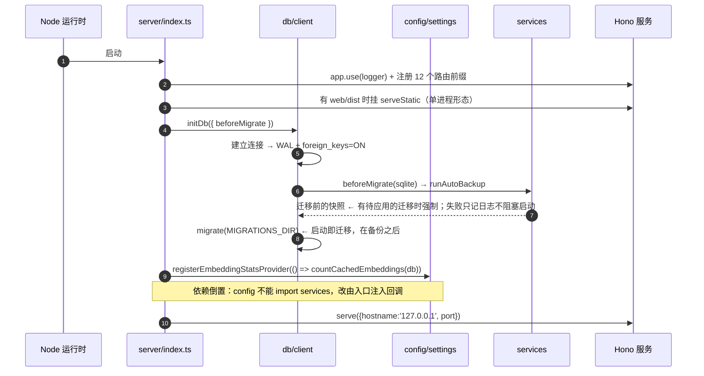

两点值得注意：

- **启动即迁移**：本地单机工具不设独立的迁移命令，应用一起来结构就绪。
  副作用是 `tsx watch` 重启即应用新迁移（见 §12 注意事项）。
- **备份在迁移之前**（`initDb` 的 `beforeMigrate` 钩子）：`data/backups/` 里那份是迁移前的状态，
  可以当回滚点；有待应用的迁移时强制备份，不受 24 小时窗口约束。

### 5.2 路由层

11 个模块挂在 `/api/*` 下，职责是**参数转换 + 校验 + 调用 service**，不含业务计算：

| 模块 | 前缀 | 端点数 | 要点 |
| --- | --- | --- | --- |
| [jobs.ts](server/routes/jobs.ts) | `/api/jobs` | 10 | 最重；`/board` 必须注册在 `/:id` **之前**；用 `formData().getAll('images')` 而非 `parseBody()` |
| [settings.ts](server/routes/settings.ts) | `/api/settings` | 8 | 密钥语义：`undefined`=保持、空串=清除；模型名放 body（可含 `/`） |
| [categories.ts](server/routes/categories.ts) | `/api/categories` | 7 | 唯一 SSE 端点（`POST /:id/roadmap`） |
| [abilities.ts](server/routes/abilities.ts) | `/api/abilities` | 6 | **能力清单唯一写入口**；`PATCH /dimensions/:key` 只改显示名、**不改键**（键是岗位条目与自评对齐的依据） |
| [progress.ts](server/routes/progress.ts) | `/api/progress` | 8 | 导出 / 备份 / 恢复在设置页「数据资产」，快照界面暂缓；恢复会换掉整个库（§5.7） |
| [skills.ts](server/routes/skills.ts) | `/api/skills` | 4 | 每次变更返回影响摘要（`InsightDiff`） |
| [aliases.ts](server/routes/aliases.ts) | `/api/aliases` | 4 | 建别名会**立即改写历史数据**；管理界面在个人信息页（弹窗），`/similarity` 仍暂缓 |
| [experiences.ts](server/routes/experiences.ts) | `/api/experiences` | 4 | 项目经验 CRUD |
| [schemaFields.ts](server/routes/schemaFields.ts) | `/api/schema-fields` | 4 | 动态字段（暂缓特性的服务端能力） |
| [dashboard.ts](server/routes/dashboard.ts) | `/api/dashboard` | 1 | 纯本地聚合，零 Token |
| [index.ts](server/index.ts#L35) | `/api/health` | 1 | 健康检查 |

统一约定：

- 错误响应一律 `{ error: { code, message, details? } }`，由 [http.ts](server/http.ts) 的 `fail()` 产出，
  code 取自 [shared/schemas/common.ts](shared/schemas/common.ts) 的 7 个枚举值。
- JSON 请求体一律走 `parseJsonBody(c, Schema)`：JSON 解析失败 → 400「请求体不是合法的 JSON」；
  zod 失败 → 400 + 字段级 `issues`。
- 全局兜底：`app.notFound` 与 `app.onError`（`onError` 先 `console.error` 完整异常再返回，**不静默吞掉**）。

### 5.3 服务层

依赖方向 `routes → services → db/schema + shared/domain`，服务之间无循环依赖。

| 模块 | 职责 | 关键导出 |
| --- | --- | --- |
| [jobStore.ts](server/services/jobStore.ts) | 岗位与要求条目读写，**所有写操作在事务内** | `createJob` / `overwriteJob` / `updateJob` / `updateRequirementVerdicts` / `deleteJobs` / `moveJobs` |
| [jobBoard.ts](server/services/jobBoard.ts) | 列表查询：筛选 / 排序 / facets / 卡片摘要；**过时判定唯一口径** | `computeJobBoard(db, query)` / `needsReevaluation` / `listStaleJobs` |
| [jobExtraction.ts](server/services/jobExtraction.ts) | LLM 原始输出 → `JobDraft` 的**规整层** | `extractJobDraft` / `toJobDraft` / `normalizeRequirementItems` |
| [jobDedup.ts](server/services/jobDedup.ts) | 同分类「同公司 + 同职位」重复判定 | `buildDuplicateKey` / `findDuplicateJob` / `findMoveConflicts` |
| [analytics.ts](server/services/analytics.ts) | 变更影响摘要 + 分类短板排行 | `captureInsightSnapshot` / `diffInsights` / `computeCategoryInsights` |
| [dashboard.ts](server/services/dashboard.ts) | 看板全量聚合 | `computeDashboard` |
| [abilityStore.ts](server/services/abilityStore.ts) | 能力清单 / 自评 / 资产快照 / 知识索引的**只读**装配 | `matchAbilityKey`（只读匹配，**绝不新建**）/ `loadUserAbilities`（有效自评：每维度一条，缺省「一般」）/ `loadAssetSnapshot` / `loadUserSkills` |
| [skillKey.ts](server/services/skillKey.ts) | 知识键唯一入口（纯函数） | `normalizeSkillKey` / `resolveSkillKey(raw, aliasMap)` |
| [skillAlias.ts](server/services/skillAlias.ts) | 别名解析 + 建别名时改写历史数据 | `loadAliasMap` / `resolveSkillKeyInDb` / `createAlias` |
| [normalize.ts](server/services/normalize.ts) | 通用文本归一化（全项目唯一实现） | `normalizeKey` |
| [salaryParse.ts](server/services/salaryParse.ts) | 薪资原文本地兜底换算（纯函数） | `parseSalaryText` |
| [roadmapCache.ts](server/services/roadmapCache.ts) | 成长路线缓存读写与过时判定 | `parseRoadmap` / `getCachedRoadmap` / `saveRoadmap` / `listStaleRoadmapCategoryIds` |
| [jobJudgement.ts](server/services/jobJudgement.ts) | 能力/经验条目的**重判**（人工与自动共用） | `judgeRequirementVerdicts` / `buildAssetSummary` |
| [roadmapGeneration.ts](server/services/roadmapGeneration.ts) | 成长路线的**生成**（SSE 与自动共用） | `generateCategoryRoadmap` / `RoadmapError` |
| [reevaluation.ts](server/services/reevaluation.ts) | 自动重新评估的去抖调度器（纯工厂，可注入 db 与模型服务） | `createReevaluationScheduler` |
| [reevaluationRuntime.ts](server/services/reevaluationRuntime.ts) | 上面那个调度器的**唯一装配点**（接真实 db 与配置） | `reevaluation.notify / runNow / status / markDataChanged` |
| [progress.ts](server/services/progress.ts) | 进度快照的写与读 | `captureProgressSnapshots` / `listProgress` / `summarizeProgress` |
| [semantic.ts](server/services/semantic.ts) | 嵌入缓存 + 余弦比对 + 同义候选（暂缓特性） | `ensureEmbeddings` / `findSimilarSkills` / `countCachedEmbeddings` / `pruneOrphanEmbeddings` |
| [dataAssets.ts](server/services/dataAssets.ts) | 导出、自动备份与整库恢复 | `runAutoBackup` / `listBackupFiles` / `exportAllData` / `restoreFromBackup` |

**两条贯穿服务层的约定**：

- **读取容错、写入显性**：读历史 JSON 损坏时降级为空数组/空对象并 `console.error` 留痕（不让一个坏字段导致整页打不开）；
  写入路径一律抛错。
- **保守合并**：提取结果里重复的要求条目，重要度取严（MUST 优先）、来源取 REQUIREMENT、
  结论取更保守的一档（`conservativeVerdict`）、要求等级取更高的一档（`stricterLevel`）。

### 5.4 LLM 接入层

依赖倒置的核心：业务代码只依赖 `LlmService` 接口（[server/llm/types.ts](server/llm/types.ts)）。

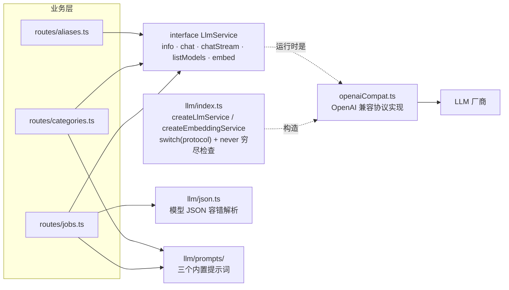

**接口形状**：

```ts
interface LlmService {
  readonly info: LlmServiceInfo   // providerId / protocol / baseUrl / model / supportsVision / hasApiKey
  chat(req: LlmChatRequest): Promise<LlmChatResult>
  chatStream(req: LlmChatRequest): AsyncGenerator<string, LlmChatResult, void>
  listModels(): Promise<string[]>
  embed(texts: string[], opts?): Promise<LlmEmbedResult>
}
```

失败一律抛 `LlmError`，携带 `kind: not_configured | auth | rate_limit | timeout | network | provider | invalid_response`。
路由层用 `mapLlmError()` 把它翻成 HTTP：`not_configured` → 400，其余 → 502。

**协议适配层的几个关键设计**（[openaiCompat.ts](server/llm/openaiCompat.ts)）：

- **超时按调用路径定死，不是设置项**：非流式对话 60s、流式生成 180s。
  提取长 JD 与逐字生成整段路线时长差一个数量级，一个用户可调的数值管不了两边。
- **输出上限降档重试**：默认 `MAX_OUTPUT_TOKENS = 8192`；厂商限制更严时（400 且错误体命中 token 上限特征）
  自动对半降档重发一次，并把结果记进进程内 `tokenCapByModel`，后续请求直接沿用。
  这让"输出上限"也不必成为用户需要理解的旋钮。
- **空内容显式失败**：提取不到文本即抛 `invalid_response`——绝不返回空字符串让上层误以为模型没话说。
- **`normalizeBaseUrl()`**：补协议（本地主机默认 http，其余 https）、去尾斜杠、
  自动剥掉误填的 `/chat/completions` 后缀。
- **云端无密钥 → `not_configured`**：不让用户去猜 401 的含义；本地地址（localhost / 127.0.0.1 / ::1 / 0.0.0.0）免密钥。

**三个内置提示词**（`server/llm/prompts/`），版本随缓存落库，作为"旧缓存是否还适用"的判据：

| 模块 | 版本 | 用途 |
| --- | --- | --- |
| [extractJob.ts](server/llm/prompts/extractJob.ts) | `extract-job-v10` | 岗位多模态提取（系统 Prompt 含 14 条规则：三类要求划分、并列拆条、重要度判据、要求等级映射……） |
| [judgeRequirements.ts](server/llm/prompts/judgeRequirements.ts) | `judge-requirements-v2` | 重新判定能力/经验条目（仅在用户点击时发生） |
| [categoryRoadmap.ts](server/llm/prompts/categoryRoadmap.ts) | `category-roadmap-v1` | 全项目唯一的大文本生成：知识学习路线 + 能力提升路径 |

提示词**没有任何面向用户的设置项**：约束（只依据给定素材、严禁编造、写不出依据就判 GAP）内置在工具里，
不需要用户去拼。

### 5.5 配置与密钥分层

四层覆盖，优先级从高到低（[server/config/settings.ts](server/config/settings.ts)）：

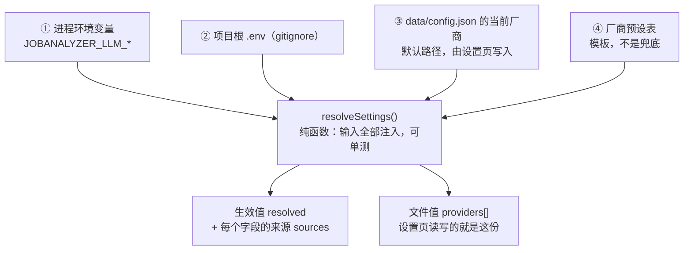

三条不许违反的规则：

1. **系统不预置任何厂商**。什么都没配时 `resolveSettings` 如实返回空地址、`sources` 标 `none`，
   由调用方报「尚未配置模型服务商」。绝不替用户挑一家——否则报出来的错会是"没有密钥"，
   用户根本不知道系统把他引导到了哪家。
2. **「存着的值」与「生效值」必须分成两个字段下发**。`providers[]` 是配置文件里的值，
   `resolved` 是含 env/.env 覆盖的生效值。合成一个字段会让界面把 env 覆盖值原样存回配置文件——
   用户撤掉环境变量后行为却变了，且无从解释。被环境变量盖住的字段由界面**明确提示**（附具体变量名）。
3. **参数跟随模型，不跟随厂商**。厂商 → 模型 → 参数逐层跟随；每个模型各存一套温度（默认 0.2，
   因为这里的调用几乎都是结构化提取，要的是稳定复现而不是发散）。

**密钥安全**（F-7.4）：

- 密钥只存本机：`data/config.json`（写入 `mode: 0o600`）或环境变量；`.env` 与 `data/` 都在 `.gitignore` 里。
- **没有任何回显入口**：没有显示/隐藏切换，掩码就是输入框的内容（复制走的也是掩码），
  Edge 自带的密码查看按钮用 `::-ms-reveal` 屏蔽。
- **掩码与待提交的新密钥是两个字段**，互不混用——掩码若混进提交字段，就有被当成密钥存进配置文件的风险。
- 任何日志与错误信息中都不出现密钥。

### 5.6 数据访问与迁移

- **连接**（[server/db/client.ts](server/db/client.ts)）：单例；建连接后立即
  `pragma journal_mode = WAL` + `pragma foreign_keys = ON`；`getSqlite()` 单独暴露原始句柄给 `VACUUM INTO` 用。
- **迁移**：14 个 `.sql`（0000–0013），由 drizzle-kit 生成，`-- > statement-breakpoint` 切分多条语句。
- **「已应用」的判定机制**：drizzle 的 migrator 建 `__drizzle_migrations` 表，
  取 `created_at` 最大值作高水位，**只执行 journal 里 `when` 大于它的条目**。
  也就是说判定依据是**时间戳比较，不是文件内容比对**——已应用过的迁移文件被改写也不会重跑。

**迁移铁律（N-1）：只增不删。** 已有数据表与列一律保留，新模型通过「新增表 + 新增列 + 数据搬迁」落地。
确认无主之后的清理是**允许的显式例外**，但必须单独做一次、写清判据，不得在升级迁移里顺手 `DROP`。
本项目至今的三次例外：

| 迁移 | 删了什么 | 判据 |
| --- | --- | --- |
| `0008` | `job_ai_cache` | 按岗位的 AI 建议整条下线，该表零读者、零数据 |
| `0010` | 履历的 7 个旧列 | 先由 `0009` 把数据搬迁进新的 `project` / `duration_months`，再删列 |
| `0013` | 从未被自评过的能力条目 | 它们是旧版「解析岗位时自动落键」产生的自动化噪音；键可由 `normalizeKey(raw_name)` 复现 |

**改数据模型前必须先留快照**：`getDb()`（跑迁移）在 `runAutoBackup()` **之前**，
所以应用内 `data/backups/` 的那份已经是迁移后的状态。用 `VACUUM INTO` 存一份到 `data/` 外面才靠得住。

### 5.7 数据资产：备份、导出与恢复

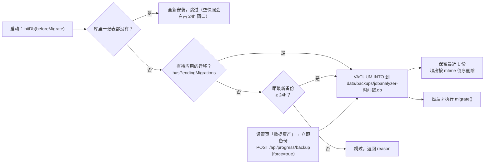

- **备份在 `migrate()` 之前**：迁移是唯一会改表结构的操作，快照必须是迁移前的状态才谈得上回滚。
  顺序由 `initDb({ beforeMigrate })` 保证（[server/db/client.ts](server/db/client.ts)）。
- 有待应用的迁移时**强制备份**，不受 24 小时窗口约束；普通重启仍走窗口，避免每次重启都把
  仅有的那一份备份重写一遍。
- **只保留最近 1 份**（2026-10-10 起，此前是 7 份）：相邻两份的差异只有一天的数据增量，
  而 `data/backups/` 是全项目唯一会随使用无限增长的目录。代价要说清楚——迁移前那份快照
  从此只多活一次备份周期（至多 24 小时）。保留逻辑由 [backupRetention.test.ts](server/services/backupRetention.test.ts) 钉住。
- 设置页「数据资产」区块显示备份列表与备份目录（`GET /api/progress/backups` 一并下发 `dir`，
  列表里只有文件名，不给目录就找不到文件），并在同一处提供导出入口。导出走 `downloadExport()`
  的 fetch 而不是 `<a href>`：失败时服务端返回的是 JSON 错误体，链接会把它存成一个
  「下载成功」的 .json 文件，错误就被静默吞掉了。
- **用 `VACUUM INTO` 而不是复制文件**：WAL 模式下直接复制可能拿到不一致的快照。
- 每份备份旁边同时落一份 `<同名>.config.json`（厂商配置与密钥原本只在 `data/config.json` 里）。
  它只写在本机 `backups/`，不经网络、也不进导出 JSON，所以不增加密钥外泄面；
  没有它，「卸掉工具再装回来」就得把厂商与密钥重配一遍。
- 文件名冲突时追加 `-1` / `-2` 后缀（`VACUUM INTO` 要求目标文件不存在）。
- 自动路径受 24 小时窗口限制，**手动点击必须真的备份**（`force: true`）。
- 备份失败不阻塞启动，但必须显性记录。

**恢复**（`POST /api/progress/restore` 从列表恢复，`POST /api/progress/restore/upload`
从本机文件恢复）。备份能带走，也要能带回来——否则它只完成了一半：

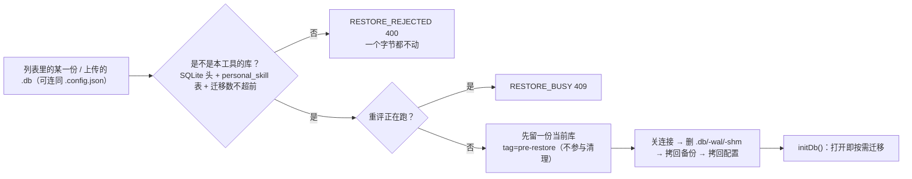

- **老备份靠迁移链升上来**：从 5 个迁移的老库到当前结构这条路，本项目每次启动都在走，
  恢复只是把它再走一遍（[restore.test.ts](server/services/restore.test.ts) 钉住了往返）。
- **恢复不做保留清理**（`prune: false`）：那一刻目录里最新的正是用户选中的那份备份，
  按保留策略清下去会把它删掉。恢复后短暂并存两份，下次备份时自然收敛。
- 恢复前的安全副本（`jobanalyzer-pre-restore-*.db`）是给「选错了」准备的退路，
  同样带配置；它和别的备份一样只活一个备份周期。
- **恢复不逐块刷新界面，而是整页重载**：库和配置是整体换掉的，页面上任何一处数据都
  可能已过期，逐块刷新要枚举全部数据源、漏一个就是「看着是新的、其实是旧的」。

**导出**（`GET /api/progress/export`）导出的是**用户数据**，不是可重算的派生缓存：

| 进导出（10 张） | 不进导出 | 理由 |
| --- | --- | --- |
| `personal_skill` / `personal_ability` / `personal_experience` / `ability_dimension` / `job_category` / `job_post` / `job_requirement` / `skill_alias` / `schema_field_config` / `track_progress_snapshot` | `skill_embedding` / `category_ai_cache` | 可本地重算；向量还是 1024 维 × N 条的长 JSON，能把这份「给人看的」文件撑到十几 MB |
| | `job_post_skill` | 自迁移 0007 起已停写，数据全量在 `job_requirement` |

表清单的完整性由 [dataAssets.test.ts](server/services/dataAssets.test.ts) 兜底：它按 `db/schema.ts`
遍历，新增表忘了加进导出就会红。`schemaVersion` 随形状变更递增（当前 `'3'`；`'3'` 去掉随
「简历原文」移除的 `profile`，`'2'` 补齐四张个人资产表并去掉已停写的 `job_post_skill`）。

---

## 6. 数据模型

### 6.1 ER 图

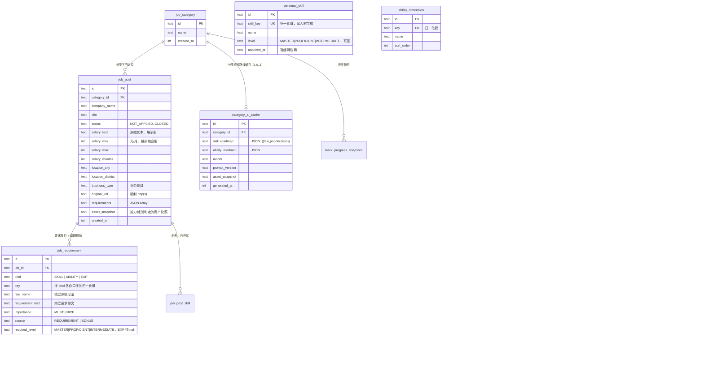

另有几张**暂缓特性或已停写**的表不在图中：`skill_alias`（仍服务匹配算法）、`skill_embedding`（语义相似度）、
`schema_field_config`（动态字段）、`track_progress_snapshot`（进度回顾，图中已示）、
`job_post_skill`（旧表，已无读者）。
`profile`（简历原文）**已于 2026-10-10 随功能移除声明**——表还在库里（迁移只增不删），
但不在 `db/schema.ts`、不进导出、没有路由。

### 6.2 表清单

| # | 表 | 定位 | 写入者 |
| --- | --- | --- | --- |
| 1 | `personal_skill` | 个人知识库 | 个人信息页 |
| 2 | `skill_alias` | 知识别名（k8s → kubernetes） | 别名接口；管理弹窗在个人信息页（手动增删，不含自动找同义） |
| 3 | `skill_embedding` | 每知识名的向量缓存（`skillKey × model`） | 语义相似度接口（暂缓） |
| 4 | `job_category` | 目标岗位分类 | 分类接口 |
| 5 | `job_post` | 岗位 | 确认入库 / 批量操作 |
| 6 | `job_requirement` | **全项目的原子单位**：要求条目 | 提取入库 / 重新评估 |
| 7 | `job_post_skill` | 旧的要求表，`0007` 起**停止写入** | — |
| 8 | `ability_dimension` | **用户自有**的能力清单 | 仅个人信息页的新增操作 |
| 9 | `personal_ability` | 能力自评（一个维度最多一条） | 个人信息页 |
| 10 | `personal_experience` | 项目经验 | 个人信息页 |
| 11 | `category_ai_cache` | 分类级成长路线缓存 | SSE 生成成功后 |
| 12 | `track_progress_snapshot` | 进度快照（暂缓） | 知识/别名变更时 |
| 13 | `schema_field_config` | 动态字段定义（暂缓） | 动态字段接口 |

> `profile`（简历原文单行表，原第 14 张）已于 2026-10-10 随功能一并移除声明；
> **表仍在库里**，`id` 固定 `'singleton'` 的单行结构没变，要恢复功能加回定义与路由即可。

**通用约定**：主键均为 `text` UUID；时间列为 `integer({mode:'timestamp_ms'})`；JSON 以 text 存储。

### 6.3 设计说明

- **为什么把知识 / 能力 / 经验合并成一张 `job_requirement`**：三维匹配度、缺口聚合、详情对比三件事，
  都只是「按 kind 分组、按 key 归并」的同一类查询。分三张表会让打分与聚合出现三条几乎相同的代码路径，
  而这类重复正是口径分裂的温床。合并后 `kind` 只影响**取值来源与判定方**，不影响存储形态。
- **`verdict` 对 SKILL 行恒为空**：知识结论由本地在读取时计算。一旦落库就会与知识库脱节——
  用户新增知识后分数却不变，这是必须避免的错误。
- **`required_level` 对 EXP 恒为 null**：个人侧只有项目与时长，没有等级可比。
- **`asset_snapshot` 挂在岗位上而非条目上**：一次解析里所有能力/经验条目共用同一份快照，
  失效判定也是整岗级别的。
- **`key` 是三类要求各自的归一化键**：知识来自 `skillKey`；能力是条目名归一化后的键
  （优先复用用户清单里的同名键）；经验用归一化文本键（仅用于同岗位内去重，不参与跨岗位聚合）。
- **`ability_dimension` 与 `personal_ability` 之间没有外键**：自评按 `dimension_key` 逻辑关联，
  删条目会连带删自评（由服务层保证）。这样岗位侧的历史条目即使清单里没有同名项也能保留。
- **`salary_text` 与数值字段并存**：前者用于展示（含「·16薪」等信息），后者用于排序与聚合。

---

## 7. 核心算法

### 7.1 知识归一化与别名解析（唯一口径）

```
normalizeKey(raw):
  1. NFKC 全角转半角
  2. 转小写
  3. 保留字母、数字、中文、+ # .     ← c++ / c# / node.js 不被破坏
  4. 合并连续空白为单个空格

resolveSkillKey(raw, aliasMap):
  1. key = normalizeSkillKey(raw)
  2. 命中 SkillAlias.aliasKey → 返回其 skillKey
  3. 否则返回 key
```

- **写入时归一化**：`personal_skill.skill_key`、`job_requirement.key(kind=SKILL)` 均在写库时完成归一化与别名解析。
- 匹配算法与统计 SQL **只读 `key`**，不做任何大小写或别名处理。
- 归一化与别名解析**只有这一个实现**，不得复制到别处（前端也不行）。
- **别名在哪建**：个人信息页「专业知识」区头的「知识别名」弹窗（2026-10-10 起）。
  建别名**立即改写**已有 `job_requirement`（改键）与 `personal_skill`（去重合并，掌握日期取更早的）；
  解除别名**不回滚**这些改写——两条都要在界面上说明，不能只写在注释里。
  弹窗全程零 Token：不碰语义相似度（那要另配 embeddings 厂商，见 02 文档 §5 第 5 条）。

### 7.2 三维匹配度

```ts
export const IMPORTANCE_WEIGHT = { MUST: 0.8, NICE: 0.2 } as const
export const VERDICT_WEIGHT    = { MATCH: 1, PARTIAL: 0.5, GAP: 0 } as const
export const DIMENSION_WEIGHT  = { SKILL: 0.5, ABILITY: 0.3, EXP: 0.2 } as const

// 单个维度：0–100；该维度没有任何条目时返回 null（无法评估）
维度分 = 100 × Σ(结论权重 × 重要度权重) / Σ(重要度权重)

// 综合分：只对**可评估**的维度按权重重新归一化；三个维度都不可评估时为 null
综合分 = Σ(维度分 × 维度权重) / Σ(参与计算的维度权重)
```

**核心取舍**：某个维度没有条目时**不参与综合分**，而不是打折蒙一个分数（旧版是"零要求 0.6 折扣"）。
这比旧规则更不容易产生误导性的高分。

**知识条结论由本地判定**（`skillVerdict`，唯一口径）：

| 用户侧 | 要求 = null | 要求一般 | 要求熟练 | 要求精通 |
| --- | --- | --- | --- | --- |
| 未录入该知识 | GAP | GAP | GAP | GAP |
| 已录入、未标注等级（老数据，按「一般」计） | MATCH | MATCH | PARTIAL | PARTIAL |
| 一般 | MATCH | MATCH | PARTIAL | PARTIAL |
| 熟练 | MATCH | MATCH | MATCH | PARTIAL |
| 精通 | MATCH | MATCH | MATCH | MATCH |

界面文案：`MATCH` 完全匹配（绿）· `PARTIAL` 需提升（黄）· `GAP` 不匹配（红）。

- **`GAP` 只表示「完全没有这项」**：它是红档，必须真的是「缺这项」。有、但等级不够（差一档还是差两档）
  一律判 `PARTIAL`——红档里混进「学得不够」，用户就分不出哪几条真的要「从零补」。
- **未标注等级（老数据）按「一般」计**：熟练度没有「未标注」这一档，界面默认就是「一般」，
  新增知识项也只会从三档里选——判定口径与界面显示必须一致，
  否则会出现「卡片上写一般、判定却按已掌握算」。
- **「要求一般」等价于不比较**：真正会扣分的只有「要求熟练」与「要求精通」。
- **能力 / 经验条结论来自模型**，录入时判定并落库；能力条目会把 `required_level` 一并送进判词 Prompt，
  程度不够同样判 `PARTIAL`（`GAP` 只用于资产里找不到相关证据）。能力不做本地等级比对——
  解耦后岗位侧与个人侧的键不再强制对齐，本地比对没有可靠依据。

**单调性不变量**：新增一项知识、或调高某项已有知识的等级，任何岗位的知识匹配度与综合匹配度**都不得下降**。
由 [shared/domain/matching.test.ts](shared/domain/matching.test.ts) 用枚举子集钉住。

### 7.3 匹配度分层（六档，全站唯一口径）

| 档位 | 区间 |
| --- | --- |
| 满分匹配 | = 100 |
| 极高匹配 | 90 – 99 |
| 良好匹配 | 80 – 89 |
| 中等匹配 | 70 – 79 |
| 偏低匹配 | 60 – 69 |
| 待提升 | < 60 |

- 满分单列一档：100 分是「要求全部满足」，与 90 分段的「极高」不是一回事。
- 阈值定义在 [shared/domain/tiers.ts](shared/domain/tiers.ts)，**卡片与看板共用同一份**；
  "档位键 → 色族"的映射在 [web/lib/tiers.ts](web/lib/tiers.ts)，颜色值在 [web/index.css](web/index.css) 的色族层。
- 无法评估（null）不参与分层，单独显示「—」。`tierDistribution` 的分母是**可评估岗位数**。

### 7.4 缺口聚合与优先级

```
输入：某分类（或全部）下的有效岗位（status ≠ CLOSED）
筛选：结论 ≠ MATCH 且 kind ∈ { SKILL, ABILITY }
      ← 等级不够（PARTIAL）同样是缺口：「有这项知识」不等于「够用」
归并：按 (kind, key) 分组
计数：COUNT(DISTINCT jobId) —— 同一岗位内重复出现只计一次
排序：该类型内按 count 降序（同数按 kind、key 保证稳定可测）
分档：条目数 ≥ 3 时按排名分位三等分（高 / 中 / 低）；
      条目数 < 3 时全部标为「中」（样本太少，不下高低判断）
```

**经验类缺口不进榜单**：经验无法通过"补一项"解决，列出来只会制造焦虑。

### 7.5 资产快照与过时检测

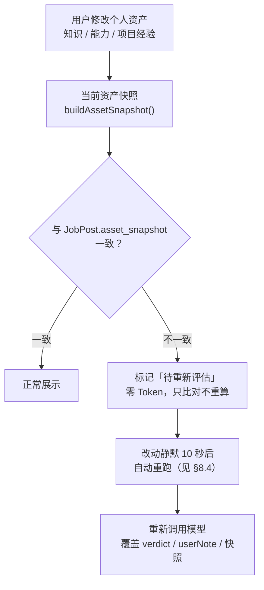

- 快照 = 知识键集合与等级 + 能力条目的**有效自评**（含默认的「一般」）+ 项目经验描述与时长的
  **排序后拼接字符串**（**刻意不哈希**：无碰撞风险、可读、便于排错）。任一资产变更即导致快照变化。
- **知识条目不参与这套机制**：它的结论永远本地实时算，因此改知识库立刻反映到分数、无需重判。
  「过时」只针对**模型给过的判词**：一条岗位若只有知识类条目，或能力/经验条目的判词本就是空的，
  它永远不会被标为待重评（判定口径只有一处：`jobBoard.needsReevaluation`）。
- 成长路线的缓存同理，只是快照挂在 `category_ai_cache` 上，**按分类粒度**失效。
- 无缓存时不生成、不请求；流式生成中断不落库。

### 7.6 能力雷达

- **轴候选 = 用户清单 ∪ 岗位提及过的键**（按提及频次取前 6；不足 6 个时按清单顺序补位）。
  只按清单取轴的话，清单为空（解耦后的常见状态）时雷达会整块空掉，界面还会说「该方向还没有提取到能力类要求」——
  而事实是有的。
- `岗位平均要求` = 100 × Σ(该轴条目的重要度权重) / 岗位数，上限 100（MUST 记 1、NICE 记 0.5）。
- `我的当前匹配` = 自评等级映射（精通 100 / 熟练 75 / 一般 50）。**我的清单里根本没有这一项**才记 0
  —— 那是岗位单方面提出、我并不具备的能力；清单里有、只是没另外改过等级的按「一般」（50）。
  与知识侧同一个口径：熟练度没有「未自评」这一档（见 §7.2 与 `abilityStore.loadUserAbilities`）。
- 两个数值都是 0–100 的**强度**，同一张图上可直接比较，口径写在图例里。

---

## 8. 关键流程

### 8.1 岗位录入（唯一的多模态链路）

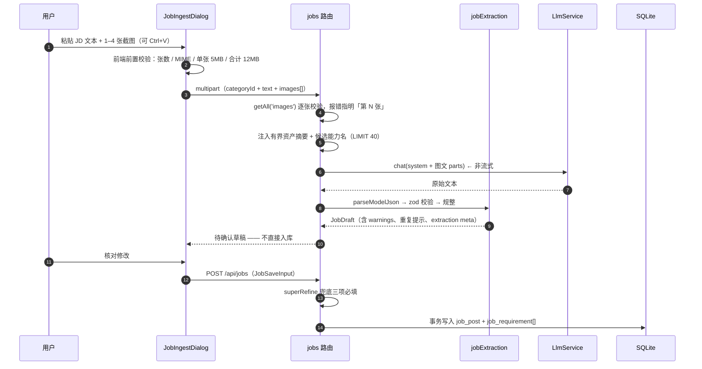

**约束与取舍**：

- **一次只录一个岗位**：文本与全部截图合成一次请求。要录下一个，再点一次。
- **待确认后再入库**：公司、地区、薪资**三项必填**——缺任意一项这条记录都是残的。
  缺失时逐项标红、就地警示、「确认入库」不可点；**服务端用同一份判定兜底**
  （`missingRequiredJobFields` 是 shared 里的纯函数，前后端共用）。
  职位描述、业务领域与岗位原链接选填；链接留空不拦入库，但填了就得是 http(s)（`OriginalUrlSchema`）。
- **失败必须显性**：解析失败必须写清原因，原文与截图保留在原处以便直接重试；
  **禁止**返回空对象让用户以为"这个岗位没有要求"。
- **重复检测**：同分类下已有「同公司 + 同职位」时提示用户选择覆盖或跳过。
- 图片**只在上传那一刻经过内存**，解析完即丢弃；不落盘、不留副本。

### 8.2 读岗位详情（零 Token 路径）

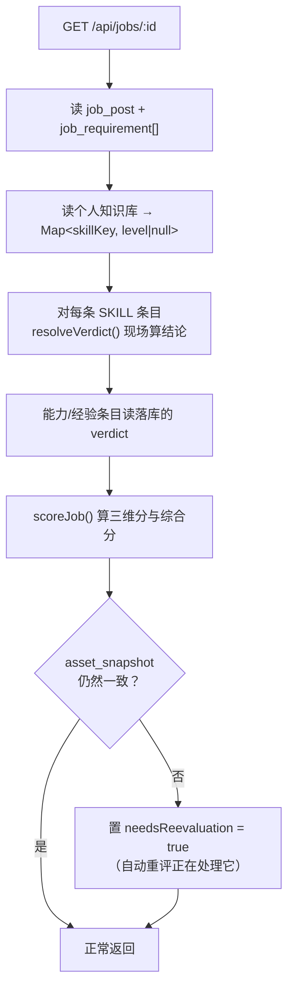

这条路径上**没有任何网络请求**，也没有任何写库；每次打开详情都重算知识结论——
这正是「新增一项知识 → 全部分数毫秒级刷新」的实现方式。

### 8.3 生成成长路线（唯一的流式链路）

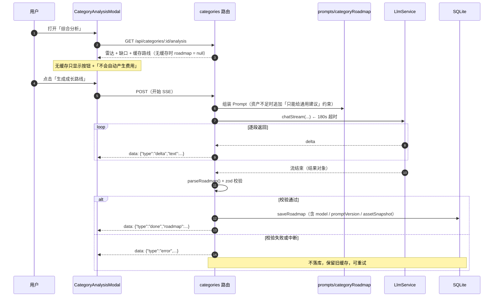

- **流式是成长路线唯一的输出方式，没有开关**；解析岗位则不用流式（结果需要整体校验后才可用）。
- 前端用 **POST + `fetch`** 而非 `EventSource` 消费：需要 POST，且需要能读到错误 JSON 体。
- 事件协议 `{type: 'delta' | 'done' | 'error'}` 定义在 [shared/schemas/roadmap.ts](shared/schemas/roadmap.ts)。
- 缓存记录**模型标识 + Prompt 版本 + 生成时刻的资产快照**，三者用于零 Token 的过时判定。
- 组装与调用在 [server/services/roadmapGeneration.ts](server/services/roadmapGeneration.ts)，
  路由只负责把增量写进 SSE 流、把异常还原成上面三种 `error.kind` ——
  因为自动重评（§8.4）要用同一份逻辑再跑一遍。

### 8.4 自动重新评估（唯一的后台任务）

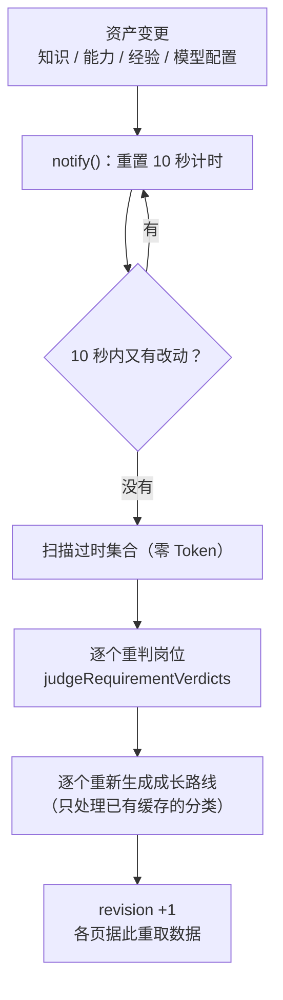

- **为什么不是「改了就立刻跑」**：用户调一次自评往往要连点几下，每一改都调一次模型是纯烧钱。
  去抖窗口固定 10 秒（`DEFAULT_DEBOUNCE_MS`），期间再改就重新计时；`notify()` 同步返回，
  绝不阻塞写操作的响应。窗口之所以不短：调一次自评常常连点几下，太短会在自动流程里积压好几轮 ——
  嫌等得久的人随时可以按状态行上的「立即重新评估」当场开跑，不必缩短窗口。
- **为什么目标集是现算的**：判词依赖的是整份资产摘要，不是「哪一条被改了」。
  新增一项知识可能让几十条岗位同时过时，跑之前扫一遍比记「谁被改过」既简单又正确。
- **基线记在每个目标自己身上**：`job_post.asset_snapshot`（每条岗位）与
  `category_ai_cache.asset_snapshot`（每条成长路线）就是各自的基线，比对即 `isSnapshotStale`。
  于是「改来改去又回到原样」（A→B→C→A）自动零开销：目标集为空，一次调用都不发。
  这一点比「全局一份基线」强 —— 后来才录入的岗位、判过一半失败的岗位，基线本就各不相同，
  一份全局基线会把它们一起标成「已同步」，而失败的那几条其实还没落上。
- **扫描必须在装配模型之前**：没有过时条目时就别去构造模型服务，否则「无事可做」会被
  报成「未配置模型」——用户改了项其实谁都不影响的资产，却在四个页面上看到一条红色的失败。
- **顺序不可调换**：先岗位、后成长路线。路线的 Prompt 里写着该方向的高频缺口，
  而那些缺口来自岗位判词 —— 先跑路线就是拿旧判词生成新路线。
- **失败不静默、也不在同一轮里重试**：单条失败记下来继续跑其余条目，失败的那条仍是过时状态，
  下一轮自然带上它；只有「模型没配好」这种整批都不可能成功的原因才中止整轮。
  `lastError` 只在本轮零失败时清空，一次瞬时失败不会在下一次成功轮询里凭空消失。
- **重启后不自动补跑**：那会在 `tsx watch` 下每存一次文件就烧一批 Token。
  状态接口现算的 `staleJobs` / `staleRoadmaps` 让界面仍能显示「有 N 项待重新评估」，
  并给一个「立即重新评估」的按钮兜底。
- 状态活在服务进程内存里（不落库），四个页面共用同一条轮询：
  [web/services/reevaluationStore.ts](web/services/reevaluationStore.ts) 是模块级单例，
  空闲 2 秒、忙碌 1 秒问一次，页面不可见时不问；状态由业务组件
  [web/components/EvaluationStatus.tsx](web/components/EvaluationStatus.tsx) 渲染成
  「检测到改动 / 正在重新评估（带进度）/ 待重新评估 / 失败 / 当前为最新评估数据」五态。

  这一行**只挂在展示评估结果的页面上**（岗位信息 / 综合看板 / 分类综合分析 / 岗位详情）。
  个人信息页一个都不挂：那一页的数据是用户手工录入的，既不受别处影响、也不替别处报账，
  在那里说「正在自动重新评估」只会让人以为**这一页自己的内容**还没存好。
  「当前为最新评估数据」是**完成回执**而不是状态标签：只在一次重评真的跑完之后出现，
  5 秒后自己收起（进页面时若本来就是最新，什么都不显示 —— 否则每次切页都先亮一下再消失，版面白跳）。
- 资产快照在**调用模型之前**取，并由调用方原样写回（`updateRequirementVerdicts` 的快照参数）：
  若写入时才现读，一次调用期间用户又改了资产，这条岗位会被盖上更新的快照而判词其实是旧资产的结论
  —— 界面上永远显示「最新」，查都查不出来。

---

## 9. 前端架构

### 9.1 页面与导航

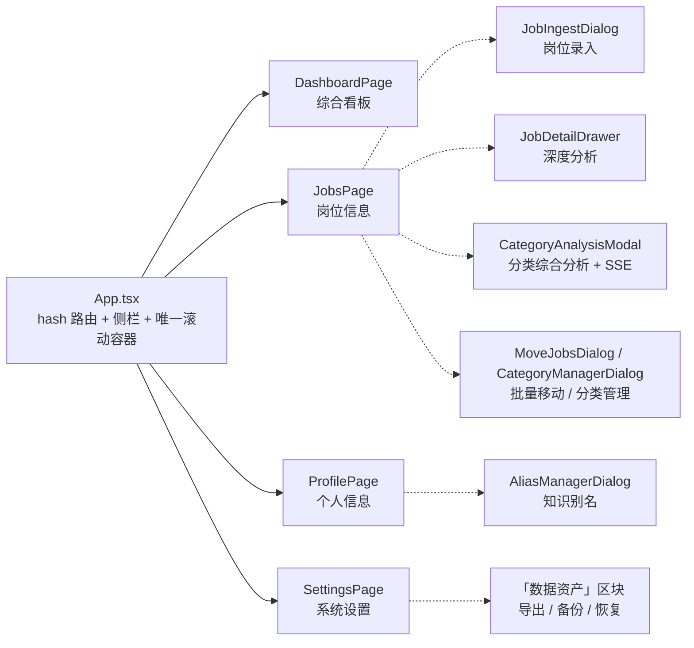

- **路由 = URL hash + `useState`**，无路由库。`viewFromHash()` 做白名单校验，非法值回落看板；
  点击导航同时 `setView` 与写 hash（双写，避免异步一跳）。
- 四个页面**条件渲染**，切页即卸载/重挂：状态不保留，每次进入重新拉数据。
- 唯一的跨页状态通道就是 URL hash。

### 9.2 组件分层

| 层 | 位置 | 分界 |
| --- | --- | --- |
| 基础件 | `web/components/ui/`（7 个） | **完全无业务知识**，不含任何 `@shared` 业务 schema 导入，只有视觉/交互原语：button / badge / card / input / modal / empty-state / segmented |
| 业务组件 | `web/components/`（10 个） | 携带业务语境：PageShell / PageHeader / SectionHeader / HeroPanel / Feedback / EvaluationStatus / JobCard / DraftCard / MoveJobsDialog / CategoryManagerDialog |
| 页面级子模块 | `web/views/` | 绑定页面上下文与 API 编排的弹窗（录入 / 详情 / 综合分析），**不上升为通用组件** |
| 页面私有小组件 | 各 view 文件底部 | 不建 barrel、不建 index.ts |

**弹窗基础设施自己维护了 z 序与栈**（[web/components/ui/modal.tsx](web/components/ui/modal.tsx)）：
模块级 `modalStack` 保证 Esc 只关最上层；`elevated` 变体抬到 `z-60` 且不再铺第二层遮罩——
专门为「录入弹窗里再开分类管理」而设。点遮罩关闭用 `mousedown` 判定，避免拖拽误关。

### 9.3 状态管理：刻意「无库」

每页自带 `useState`（数据 + 草稿 + 筛选 + 弹窗状态）、`useCallback(load)`、`cancelled` 竞态标志；
写操作后重拉数据；**跨页零业务状态**——唯一的例外是自动重评估的状态（见 §8.4）：
它由服务端持有、四个页面共看同一条，所以放在 `web/services/reevaluationStore.ts` 里做成
模块级单例（`useSyncExternalStore` + 引用计数订阅，订阅者归零即停），而不是塞进某个页面。

| 取舍 | 说明 |
| --- | --- |
| 不引 redux / zustand | 4 个页面、页面间无共享状态，引状态库只增加样板 |
| 不引 react-query / SWR | 没有跨页缓存需求；每次进页重新拉是最简单且永远正确的策略。「别处改了要不要重取」由重评估状态里的 `revision` 回答（一个数字，不是一套缓存） |
| 不引 react-hook-form | 表单数量少，受控 state 足够；zod 只用于**响应**校验 |
| 代价 | 切页会重新请求、页面内状态不保留 —— 在这个规模下可以接受 |

**写操作返回「变更后的聚合体」而非 `{ok}`**（如 `createSkill → SkillMutationResult`、
`saveProvider → PublicSettings`），把重算留在服务端，前端不拼第二套状态。

### 9.4 API 客户端（唯一 HTTP 出口）

[web/services/api.ts](web/services/api.ts) 的结构：

1. 顶部近 90 行全是 `@shared/schemas/*` 的 import——**前端不定义任何业务 schema**。
2. `handleResponse()`：非 2xx 时用 `ApiErrorSchema` 解析服务端错误体并原样抛出；2xx 用调用方给的
   schema `safeParse`，不符则抛 `CONTRACT_MISMATCH` 并把 `issues` 打进控制台。
3. `NETWORK_ERROR` / `CONTRACT_MISMATCH` 是**前端自造**的错误码，不在服务端契约枚举里（有意的分层）。
4. `requestForm()` **刻意不设 `Content-Type`**，让浏览器自己补 multipart boundary。
5. `streamRoadmap()` 是 `async function*`：`getReader()` + `TextDecoder`，按 `\n\n` 切事件、
   `buffer` 留残段、逐行取 `data:` 前缀；**只有 `done` 事件过 zod**（`delta` / `error` 直传）。

### 9.5 设计令牌：三层收敛

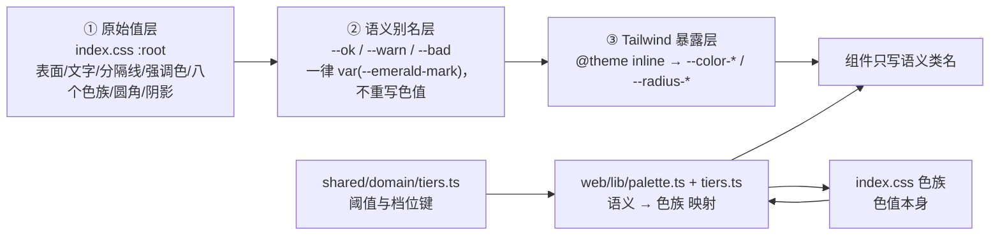

- **色族的数量就是这套系统的颜色上限**：`Tone` 共八个色族
  （`slate` / `accent` / `emerald` / `cyan` / `amber` / `yellow` / `violet` / `rose`），
  每个色族固定五档（`-mark` / `-ink` / `-soft` / `-line` / `-on-dark`）。
  新增语义必须**复用现有色族**，不新开近似色。
- **语义映射在 JS 不在 CSS**：`index.css` 只把颜色变成可用的工具类，"哪个档位/状态用哪个族"
  一律在 `web/lib/palette.ts` 与 `web/lib/tiers.ts` 里映射。`toneClass()` 用查表而不是拼字符串——
   Tailwind 扫描不到拼接出来的类名。
- **状态色只有一张表**：`JOB_STATUS_TONE` 同时供岗位卡片的胶囊与看板的环形图使用，
  不允许出现"同一状态两种颜色"。
- 字号补档 `--text-3xs / --text-2xs` 与图标尺寸（`inline / control / nav / display`）
  也都在令牌与共享组件里，组件不许另立一套。
- Tailwind v4 **CSS-first**：没有 `tailwind.config.js` / `postcss.config.js`，配置通过 `@theme inline` 完成。
- **不加载 webfont**（原型引 Google Fonts，实现改为回落 Segoe UI / 微软雅黑）——本地工具断网也必须能用。

### 9.6 页面切换稳定性

「切页不抖」是一套组合拳，而非单点：

| 手法 | 位置 |
| --- | --- |
| 加载态与正式态**共用同一份 header 常量** | 三个页面各有一份同款写法 |
| 唯一的滚动容器 + `scrollbar-gutter: stable` | `App.tsx` 的 `main.scroll-area` + `index.css` |
| 换页归零滚动位置用 `useLayoutEffect` | `App.tsx`（否则会先按旧位置画一帧再跳） |
| `PageContainer` 是全站宽度的**唯一决定处** | `web/components/PageShell.tsx` |
| 入场动画受 `prefers-reduced-motion` 约束 | `index.css` 的 `rise-in` |

---

## 10. HTTP 接口清单

统一前缀 `/api`；错误体一律 `{ error: { code, message, details? } }`。

`web/dist/` 存在时，非 `/api/` 的 GET 由同一进程静态托管（产物里没有的路径回落 `index.html`）；
`/api/` 下的未知路径仍然是上面的 JSON 404，不会被回落吞掉（见 §5.1）。

### 10.1 岗位

| 方法 | 路径 | 作用 |
| --- | --- | --- |
| GET | `/jobs/board` | 跨分类列表：筛选 + 排序 + 打分 + facets **全部服务端算** |
| GET | `/jobs?categoryId=` | 单分类岗位列表（带匹配分） |
| POST | `/jobs/extract` | **多模态提取**：multipart（文本 + 1–4 张截图）→ `JobDraft` |
| POST | `/jobs` | 确认入库（新建 / 跳过 / 覆盖）；重复且未指定策略 → 409 |
| GET | `/jobs/:id` | 详情：三维匹配 + 三类要求逐条 + `needsReevaluation` |
| PATCH | `/jobs/:id` | 修改岗位（含投递状态推进） |
| DELETE | `/jobs/:id` | 删除（要求条目外键级联） |
| POST | `/jobs/:id/reevaluate` | 重判这一条岗位的能力/经验条目（自动流程失败或服务重启后的**兜底重试**；常态由 §8.4 自动完成） |
| POST | `/jobs/batch/delete` | 批量删除 |
| POST | `/jobs/batch/move` | 批量移动分类；目标有重复则**整批拒绝** |

### 10.2 个人信息与资产

| 方法 | 路径 | 作用 |
| --- | --- | --- |
| GET / POST | `/skills` | 知识项列表 / 新增（归一化查重 → 409） |
| PATCH / DELETE | `/skills/:id` | 改名（重归一化 + 冲突检查）/ 改等级 / 删除；每次变更返回**影响摘要** |
| GET / POST | `/experiences` | 项目经验列表 / 新增 |
| PATCH / DELETE | `/experiences/:id` | 修改 / 删除 |
| GET | `/abilities` | `{ dimensions, abilities }` 概览；`abilities` 是**有效自评**，与 `dimensions` 一一对应 |
| POST | `/abilities/dimensions` | **能力清单唯一写入口** |
| PATCH | `/abilities/dimensions/:key` | 重命名（**只改显示名、不改键**：键是岗位侧条目与自评对齐的依据） |
| DELETE | `/abilities/dimensions/:key` | 删除维度（连带自评；岗位侧条目保留） |
| PUT | `/abilities` | 某维度自评 upsert。**没有「移除自评」**：熟练度没有「未自评」这一档 |

### 10.3 分类 · 看板 · 进度

| 方法 | 路径 | 作用 |
| --- | --- | --- |
| GET / POST | `/categories` | 分类列表（带岗位数）/ 新建 |
| PATCH / DELETE | `/categories/:id` | 改名 / 删除（**级联删岗位**，返回 `deletedJobs`） |
| GET | `/categories/:id/insights` | 分类级短板洞察（纯 SQL 聚合） |
| GET | `/categories/:id/analysis` | 综合分析：雷达 + 缺口 + 缓存路线（无缓存时 `roadmap: null`） |
| POST | `/categories/:id/roadmap` | **SSE** 流式生成成长路线 |
| GET | `/dashboard` | 综合看板：KPI / 分布 / 分层 / 待提升项 |
| GET | `/reevaluation` | 自动重新评估的状态（零 Token 的过时计数 + 进度 + `revision`） |
| POST | `/reevaluation/run` | 跳过去抖立即开跑（202，不等它跑完） |
| GET | `/progress` | 进度摘要与快照点 |
| POST | `/progress/snapshot` | 手动落快照 |
| GET | `/progress/export` | 全量 JSON 导出（11 张用户数据表，表清单见 §5.7） |
| GET / POST | `/progress/backups` | 备份列表（含目录与 `hasConfig`）/ 立即备份（`force: true`） |
| GET | `/progress/backups/:file` | 下载某一份备份（.db 原样；只接受 basename，挡路径穿越） |
| POST | `/progress/restore` | 从列表里的某一份整库恢复 |
| POST | `/progress/restore/upload` | 从本机文件整库恢复（`.db` 必需，`.config.json` 可选） |

### 10.4 设置 · 其它

| 方法 | 路径 | 作用 |
| --- | --- | --- |
| GET | `/settings` | 公开设置（**永不含明文密钥**；文件值与生效值分两份下发） |
| PUT / DELETE | `/settings/providers[/:id]` | 新增/更新 / 删除厂商 |
| POST | `/settings/providers/:id/activate` | 设为当前厂商 |
| PUT | `/settings/model-params` | 保存某模型自己的推理参数（模型名放 body，可含 `/`） |
| PUT | `/settings/embedding` | 嵌入模型配置（界面暂缓，接口保留） |
| POST | `/settings/test` | 连通性 + 能力探测（文本 / 图像；图像探测会核对答复是否答对探测图的颜色） |
| GET | `/settings/models` | 拉取厂商模型列表 |
| GET / POST | `/aliases` | 别名列表 / 建别名（**立即改写历史数据**） |
| DELETE | `/aliases/:id` | 删除别名（不回滚已合并的历史数据） |
| POST | `/aliases/similarity` | 语义相似候选（唯一产生嵌入 Token 的入口） |
| GET / POST | `/schema-fields` | 动态字段列表 / 新建 |
| PATCH / DELETE | `/schema-fields/:id` | 修改 / 删除定义（历史数据保留） |
| GET | `/api/health` | 健康检查 |

---

## 11. 非功能性设计

### 11.1 Token 边界

**只有三件事调用大模型**：解析岗位（录入时，一次性）、重判岗位的能力/经验判词、
生成成长路线。（后两件都由「自动重新评估」驱动，见 §8.4 —— 资产变了才跑、
去抖 10 秒、只处理真正过时的条目。）其余全部本地。由此推出四条硬约束：

1. **单次请求的注入量与库总量无关**：资产摘要取前若干条、候选能力名 `LIMIT 40`、缺口各取 8 条、
   履历压成单行。禁止把全量岗位塞进 Prompt。
2. **打开任何页面都不产生请求**：详情页、看板、切分类、状态轮询——全部零 Token
   （过时与否是本地比对快照得出的）。页面**不会**因为被打开而触发重评。
3. **自动重评的触发面很窄**：只在个人资产或模型配置发生写操作之后；目标集是现算的过时集合，
   没有过时条目就一次调用都不发；从没生成过成长路线的分类永远不会被自动生成。
4. **未配置 LLM 时，除上述三件事外的功能必须全部可用**；自动重评遇到
   `not_configured` 立刻中止整轮并把原因显示在状态行上，不做无谓重试。

### 11.2 性能

本地计算路径（列表、筛选、统计、缺口聚合）在 10² 量级岗位下 P95 < 100ms。
列表查询建在 `job_category(category_id, status)` 与 `job_requirement(kind, key)` 两个索引上。

### 11.3 隐私

- 调用模型时只发送必要内容：解析岗位发送 JD 原文 + **个人资产摘要**（知识名 + 能力维度名 + 项目经验摘要），
  不发送与本次解析无关的岗位数据。
- 删除操作一律二次确认；批量操作必须在执行前说明影响范围。
- 只监听 `127.0.0.1`；无账号、无遥测、无外部存储。

### 11.4 失败必须显性

- 提取失败、JSON 不合法、模型未给结论、数据库写入异常，都必须捕获并在 UI 上说明**是哪一条失败了**，
  同时记录完整日志。
- `JobDraft.warnings` 会把每一次自动修正写出来；未判定的能力/经验条目单独计数并在界面上标注。
- 界面反馈节奏（约定）：结果当场可见的操作**不弹成功提示**；成功 4s、失败 10s 自动收起并留在操作现场。

### 11.5 反模式清单（严格禁止）

1. 在业务代码里直接拼厂商 URL / 模型名 / 密钥（必须走 `LlmService` 与配置层）。
2. 复制一份归一化或打分逻辑到别处（前端也不行）。
3. 把模型的自由文本直接当成结构化数据用（必须经 zod 校验 + 规整）。
4. 未配置模型时让功能整体不可用。
5. 自动调用模型（打开详情页、切换分类、刷新看板都不该产生请求）。
6. 静默吞掉错误或返回空对象代替失败。
7. 删除或覆盖用户数据来"修复"状态。

---

## 12. 运行、测试与已知偏差

### 12.1 命令

| 命令 | 作用 |
| --- | --- |
| `npm run dev` | 同时起本地服务（8787）与前端 dev server（5173） |
| `npm run typecheck` | `tsc --noEmit`（覆盖 server / shared / web / tests） |
| `npm test` | `vitest run` |
| `npm run build` | `vite build` → `web/dist/` |
| `npm start` | 单进程形态：服务端直接托管 `web/dist/`，开 `http://127.0.0.1:8787` 即完整应用（先 `npm run build`） |
| `npm run db:generate` | `drizzle-kit generate`（生成新迁移） |

### 12.2 端到端验证必须用隔离实例

```bash
JOBANALYZER_DATA_DIR=<临时目录> PORT=8799 npx tsx server/index.ts
JOBANALYZER_API_TARGET=http://127.0.0.1:8799 npx vite --port 5199
```

**绝不针对用户日常使用的那份数据做写操作**——曾经因为对用户实例写配置，把他的 API Key 覆盖掉了。
做迁移演练时用 `VACUUM INTO` 从真实库导一份一致快照（含 WAL）。

### 12.3 测试体系

| 项 | 值 |
| --- | --- |
| 测试文件 | 27 个（server 22 + shared 5），**前端零测试** |
| 用例数 | 271 |
| 代码量 | 测试 4,014 行 / 生产 15,968 行（ts + tsx + css，均不含 `scripts/` 与 `prototype/`） |
| 环境 | Vitest，`environment: 'node'`，无 jsdom、无 setupFiles |
| 隔离手段 | ① `createDb({ file: ':memory:' })` + 真实迁移；② `JOBANALYZER_DATA_DIR` 指向临时目录；③ 实现 `LlmService` 的假服务 / `vi.stubGlobal('fetch')` |

重点覆盖：匹配与单调性不变量、六档边界、缺口聚合口径（含"等级不够也算缺口"）、
解耦回归（保存/删除岗位后个人侧三张表必须零变化）、清理型迁移的判据、提取规整、
旧配置形态兼容（**不丢密钥**）、筛选与 facets 不坍缩。

`vitest.config.ts` **刻意独立于 `vite.config.ts`**：后者 `root: 'web'` 会漏掉 server 侧测试。

### 12.4 已知偏差与核实过的技术债

**A. 文档与实现的偏差**（`docs/spec/` 尚未同步，本文以实现为准）

| 位置 | 偏差 |
| --- | --- |
| `01-usageExamples.md` 场景一 | 写着「解析岗位时模型提出的新能力也会落成维度」——该行为已在 2026-10-07 解耦中撤销（02 文档 F-1.3 与 03 文档 §4.6 均已改为"只读匹配、绝不新建"） |
| `02-requirements.md` F-3.5 / F-4.3、`01-usageExamples.md` 场景四、`03-architecture.md` §4.5 | 写着「能力/经验判词**必须由用户点击才重算，不得自动重算**」——已于 2026-10-10 改为自动：资产变更后去抖 10 秒自动重跑，界面用状态行说明进度（本文 §7.5 / §8.4 为准）。成长路线**首次生成**仍然只在用户点击时发生，只有已缓存且过时的才自动重生成 |
| `02-requirements.md`、`03-architecture.md` §4.6、`04-construction.md` §3 | 能力自评的「未自评」档已于 2026-10-10 取消：维度建了就等于有这一项，没自评的按「一般」计（见 §7.6 与 `abilityStore.loadUserAbilities`）。故 `DELETE /api/abilities/:key`（撤销自评）同时下线 |
| `03-architecture.md` §5 | 目录结构一节只列了部分服务，未含 `jobDedup` / `normalize` / `salaryParse` / `progress` / `semantic` / `dataAssets` 等 |
| `web/dist/` | 构建产物的 `base` 为默认 `/`，直接以 `file://` 打开取不到 `/assets/*`；服务端已托管它（见 §5.7 与 §12.1 的 `npm start`），所以完整形态有两种：dev（vite + 代理）与单进程 |
| `prototype/` | 仍是上一代设计的静态参照（个人信息页区块名、设置页若干已下线的控件），**不与实现追平**，这是有意的 |

**B. 核实过的代码缺陷**（本文写作时逐条验证）

| # | 位置 | 问题 |
| --- | --- | --- |
| 4 | [server/services/analytics.ts:60](server/services/analytics.ts#L60) | `diffInsights` 的 `changedCategories` 恒为 `[]` |
| 5 | [web/views/JobDetailDrawer.tsx:87](web/views/JobDetailDrawer.tsx#L87) | 名为"抽屉"，实现是**居中 Modal**；原型是右侧抽屉 |

> 2026-10-07 已修掉原先的第 1、2、3、6、7、8 条（导出补齐、迁移前备份、向量缓存清理、
> 图像探测核对答案、`STATUS_ORDER` 与 `toErrorMessage` 收敛、一次性响应契约回到 `shared/`）。
> 对应的防线是新增的三个测试文件：`dataAssets.test.ts`（导出表清单按 schema 遍历）、
> `pendingMigrations.test.ts`、`probes.test.ts`。

**C. 工程注意事项**（很容易踩）

1. **迁移前的快照由启动流程自己留**：`initDb({ beforeMigrate })` 在 `migrate()` 之前跑备份，
   有待应用的迁移时强制备份。手工改数据模型时仍建议先手动备份一次（`POST /api/progress/backup`）。
2. **`tsx watch` 会在改 `server/` 下任何文件时重启，重启即应用新迁移**——生成迁移文件的时机要注意。
3. **迁移只增不删**：确认无主的清理必须单独做一次并写清判据（见 §5.6 的三次例外）。
4. **前端别单独用 `leading-*` 配 `text-*`**：tailwind-merge 认为两者冲突，只保留写在后面的那个，
   改用 Tailwind v4 的 `text-xl/[1.4]` 斜杠写法把行高写进字号类；`leading-none` 会把带下伸部的字母切掉。
5. **深色底上的 `<select>` 要给 `<option>` 显式写 `bg-surface`**：Chromium 的下拉浮层会沿用 select
   自身的深色底，只给文字色（`text-ink`）时展开后是深字压深底——不悬停到那一项就一个字都看不见
   （岗位页的筛选条踩过，见 `JobsPage.tsx` 的 `FILTER_CONTROL`）。

---

## 13. 附录

### 13.1 术语对照表（代码名 / 界面文案两套，不得混用）

| 代码名 | 界面文案 |
| --- | --- |
| `PersonalSkill` | 专业知识 / 知识项 |
| `PersonalExperience` | 项目经验 |
| `AbilityDimension` / `PersonalAbility` | 技能与能力 / 能力维度、能力自评 |
| `RequirementKind.SKILL / ABILITY / EXP` | 知识要求 / 能力要求 / 经验要求 |
| `MatchVerdict.MATCH / PARTIAL / GAP` | 完全匹配 / 需提升 / 不匹配 |
| `Importance.MUST / NICE` | 硬性要求 / 加分项 |
| `ProficiencyLevel.MASTER / PROFICIENT / INTERMEDIATE` | 精通 / 熟练 / 一般 |
| `GapPriority.HIGH / MEDIUM / LOW`（+ `KEEP`） | 高优先级 / 中优先级 / 低优先级 / 优势巩固 |
| `JobStatus.NOT_APPLIED … REJECTED`（+ `CLOSED`） | 未投递 / 已投递待回应 / 面试中 / 已发Offer / 已被拒绝 / 已关闭 |

> 「技能」这个词装不下 Python 语言、LLM 原理这类知识点，界面已全面改用「知识」；
> 但**代码与数据模型里仍叫 Skill**（`skillKey`、`/api/skills`、`RequirementKind.SKILL`）——改的只是说法，不动数据。

### 13.2 图索引

| 图 | 位置 |
| --- | --- |
| 系统上下文图 | §3.1 |
| 分层与依赖方向 | §3.2 |
| 启动装配序列 | §5.1 |
| LLM 接入层结构 | §5.4 |
| 配置四层覆盖 | §5.5 |
| 备份流程 | §5.7 |
| ER 图 | §6.1 |
| 资产快照与过时检测 | §7.5 |
| 岗位录入序列 | §8.1 |
| 读岗位详情（零 Token） | §8.2 |
| 成长路线 SSE 序列 | §8.3 |
| 前端页面结构 | §9.1 |
| 设计令牌三层收敛 | §9.5 |
